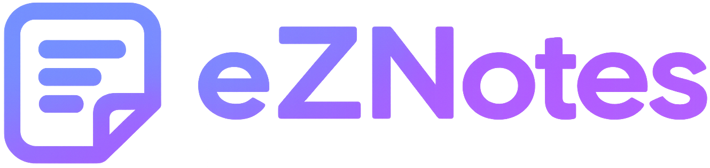
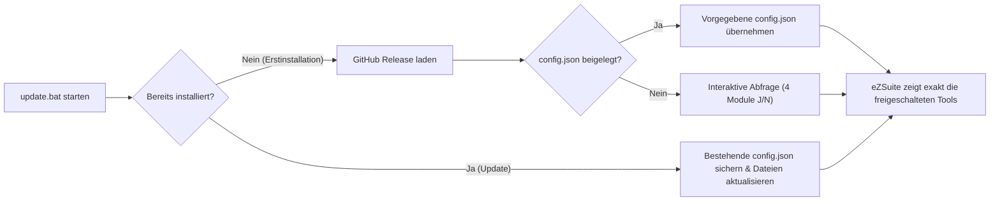

<div align="center">


# eZSuite 3.0

**Die modulare Productivity- & ERP-Engineering-Suite für Google Chrome**

[](https://github.com/SaschaArend/eZSuite)
[](https://developer.chrome.com/docs/extensions/mv3/)
[](#4--ezsnippetz--code-vault--live-web-expander)
[](#-architektur--datenhaltung)

<p align="center">
  <a href="https://saschaarend.github.io/eZSuite/"><strong>🌐 Interaktive Landingpage & Config-Generator öffnen</strong></a>
  &nbsp;·&nbsp;
  <a href="https://raw.githubusercontent.com/SaschaArend/eZSuite/main/update.bat"><strong>⬇️ Installer (update.bat) herunterladen</strong></a>
  &nbsp;·&nbsp;
  <a href="#-schnellstart-in-60-sekunden"><strong>🚀 Installation</strong></a>
</p>

</div>

---

## 🧩 4 Werkzeuge. 1 zentrale Erweiterung.

**eZSuite** ersetzt vier separate Einzel-Tools durch eine einheitliche, blitzschnelle Chrome-Erweiterung. Über das ziehbare Logo-Karussell im Popup wechselst du nahtlos zwischen den Modulen – oder blendest nicht benötigte Tools per [`config.json`](config.json) für einzelne Teams komplett aus.

<table>
  <tr>
    <td width="50%" valign="top">
      <p align="center">
        
      </p>
      <h3 align="center">01 · eZNotes</h3>
      <p align="center"><em>Automatisierte Prozess- & Klick-Dokumentation</em></p>
      <ul>
        <li><b>Smart-Capture:</b> Erfasst bei jedem Klick automatisch zugeschnittene JPEG-Screenshots inkl. ERP-Session- & Feldnamen.</li>
        <li><b>Editor & DSGVO-Blur:</b> Sensible Daten verpixeln, Fokus-Rahmen, Richtungspfeile & Kapitel-Trenner setzen.</li>
        <li><b>Multi-Export:</b> Gebrandetes PDF-Handbuch, YouTrack-Markdown, Offline-HTML-Tour & Live-Overlay-Guide.</li>
      </ul>
    </td>
    <td width="50%" valign="top">
      <p align="center">
        
      </p>
      <h3 align="center">02 · eZTimeTracker</h3>
      <p align="center"><em>Zeiterfassung & YouTrack-Ticket-Reporting</em></p>
      <ul>
        <li><b>1-Klick Stempeluhr:</b> Live-Timer direkt im Popup oder manuelle Nachbuchung im Dashboard.</li>
        <li><b>YouTrack-Integration:</b> CSV-Ticket-Import mit Status-Filter, Fälligkeits-Warnung und Direktbuchung.</li>
        <li><b>Berichte:</b> PDF-Stundennachweise (mit eigenem Firmenlogo), CSV- und Markdown-Export.</li>
      </ul>
    </td>
  </tr>
  <tr>
    <td width="50%" valign="top">
      <p align="center">
        
      </p>
      <h3 align="center">03 · eZClip</h3>
      <p align="center"><em>Text- & Clipboard-Transformations-Studio</em></p>
      <ul>
        <li><b>Popup Quick-Actions:</b> Bis zu 4 frei belegbare Schnellaktionen transformieren die Zwischenablage mit 1 Klick.</li>
        <li><b>14 Entwickler-Transformer:</b> SQL-<code>IN</code>-Quoter, JSON-Formatter, Sort & Unique, Case-Konverter, Base64 & URL-Codec.</li>
        <li><b>RegEx & Verlauf:</b> Suchen/Ersetzen inkl. RegEx sowie chronologische Clipboard-Historie.</li>
      </ul>
    </td>
    <td width="50%" valign="top">
      <p align="center">
        
      </p>
      <h3 align="center">04 · eZSnippetZ</h3>
      <p align="center"><em>Code-Vault, Infor LN 4GL Tools & Web-Expander</em></p>
      <ul>
        <li><b><code>//</code> Live Web-Expander:</b> Tippe in jedem beliebigen Browser-Textfeld <code>//</code> zum direkten Einfügen von Snippets.</li>
        <li><b>Dynamische Variablen:</b> Unterstützt Dropdowns, Datumsrechner, Bedingungen (<code>#if</code>) & Live-Vorschau.</li>
        <li><b>Infor LN 4GL Suite:</b> Integrierter BaanC-Formatter, Linter, Tabellen-Lexikon & lokale Ordner-Synchronisation.</li>
      </ul>
    </td>
  </tr>
</table>

---

## ⚡ Highlight: `eZSnippetZ` Live-Expander & Variablen-Syntax

Egal ob in **YouTrack**, **Jira**, **Infor LN Web-UI** oder im **Webmail**: Tippe einfach `//` (z. B. `//select`) in ein Eingabefeld oder wähle **Rechtsklick → eZSnippetZ einfügen**.

```baanc
| Select ${TABLE:tcibd001} mit dynamischen Platzhaltern
db.retry.point()
select  ${TABLE:tcibd001}.*
from    ${TABLE:tcibd001} for update
where   ${TABLE:tcibd001}._index1 = {:${KEY:i.item}}
selectdo
    | Bearbeiter: {Name} am {Datum} (Frist: {Datum+14})
    | Priorität:  {Prio=[Hoch,Mittel,Tief]}
    dal.change.object("${TABLE:tcibd001}")
    ret = dal.save.object("${TABLE:tcibd001}")
    if ret = 0 then
        commit.transaction()
    else
        abort.transaction()
    endif
endselect
```

### Unterstützte Platzhalter-Befehle

| Syntax | Funktion | Beispiel-Ausgabe |
| :--- | :--- | :--- |
| `{Variable}` / `${VAR:Standard}` | Fragt den Wert beim Einfügen/Kopieren im Dialog ab | *Benutzereingabe* |
| `{Name=Max Mustermann}` | Textfeld mit vorausgefülltem Standardwert | `Max Mustermann` |
| `{Prio=[Hoch,Mittel,Tief]}` | Erzeugt ein **Dropdown-Auswahlmenü** im Abfrage-Dialog | `Hoch` |
| `{Notiz:multiline}` | Erzeugt ein **mehrzeiliges Textfeld** im Abfrage-Dialog | *Mehrzeiliger Text* |
| `{Kuerzel:uppercase}` | Wandelt die Eingabe automatisch in GROSSBUCHSTABEN um | `SAR` |
| `{Datum}` / `{Datum+14}` | Aktuelles Tagesdatum (optional `+X` oder `-X` Tage) | `24.11.2026` |
| `{Uhrzeit}` / `{Clipboard}` | Aktuelle Uhrzeit bzw. aktueller Inhalt der Zwischenablage | `09:45` |
| `{#if Var}Text{#else}Alt{/if}` | **Bedingter Block** (nur aktiv, wenn `Var` ausgefüllt ist) | *Dynamisch* |
| `[[Titel]]` / `{Snippet:Titel}` | Bindet ein anderes Snippet rekursiv an dieser Stelle ein | *Snippet-Inhalt* |

---

## 🛠️ Modul-Steuerung & Team-Rollout (`config.json`)

Mit der Datei [`config.json`](config.json) im Programmordner steuerst du zentral, welche der 4 Werkzeuge sichtbar und aktiv sind. Nicht benötigte Module werden im Popup-Karussell und in den Hintergrund-Skripten vollständig ausgeblendet.



```json
{
  "eZNotes": true,
  "eZTimeTracker": true,
  "eZClip": true,
  "eZSnippetZ": true
}
```

> [!TIP]
> **Vorkonfigurierter Rollout für Kollegen:**
> Auf der **[interaktiven Projektseite](https://saschaarend.github.io/eZSuite/#configurator)** kannst du dir per Klick eine individuelle `config.json` zusammenklicken, herunterladen und direkt zusammen mit der `update.bat` weitergeben.

---

## 🚀 Schnellstart in 60 Sekunden

1. **[`update.bat` herunterladen](https://raw.githubusercontent.com/SaschaArend/eZSuite/main/update.bat)** und per Doppelklick ausführen.
2. Bei der Erstinstallation lädt das Skript automatisch die aktuelle Version nach `%USERPROFILE%\eZSuite` und fragt ab, welche der 4 Module du aktivieren möchtest.
3. Chrome öffnet sich automatisch mit `chrome://extensions`:
   - Oben rechts den Schalter **Entwicklermodus** aktivieren.
   - Oben links auf **Entpackte Erweiterung laden** klicken.
   - Den Ordner `%USERPROFILE%\eZSuite` auswählen.

---

## ⌨️ Wichtige Tastenkürzel

| Tastenkürzel | Bereich | Aktion |
| :--- | :--- | :--- |
| `//` + *Suchbegriff* | Jede Webseite | Öffnet den **eZSnippetZ** Live-Expander direkt am Cursor |
| `Strg + K` | eZSnippetZ Vault | Öffnet die **Command Palette** zur Blitz-Suche & Kopie |
| `Strg + Z` / `Strg + Y` | eZNotes Editor | Unbegrenztes Rückgängig / Wiederherstellen für Marker & Edits |
| `Strg + S` / `C` / `D` | eZSuite Popup | Quick-Save / Aktuellen Screenshot kopieren / Direkt-Download |

---

## 🔒 Architektur & Datenhaltung

- **100 % Lokal & Offline-fähig:** Keine externen Server, keine Cloud-Zwänge, keine Telemetrie.
- **IndexedDB Binary Blob Engine:** `eZNotes` speichert hochauflösende Screenshots als komprimierte Binär-Blobs direkt in IndexedDB und hält das `chrome.storage.local` frei – selbst Sessions mit über 100 Schritten laufen verzögerungsfrei.
- **File System Access API:** Sowohl die `eZNotes`-Bibliothek als auch der `eZSnippetZ`-Vault lassen sich direkt mit lokalen Ordnern auf deiner Festplatte (oder einem Netzlaufwerk/OneDrive) synchronisieren.

---

<div align="center">
  <sub>Entwickelt mit Fokus auf Präzision und Geschwindigkeit · <b>Copyright © 2026 Sascha Arend</b></sub>
</div>
